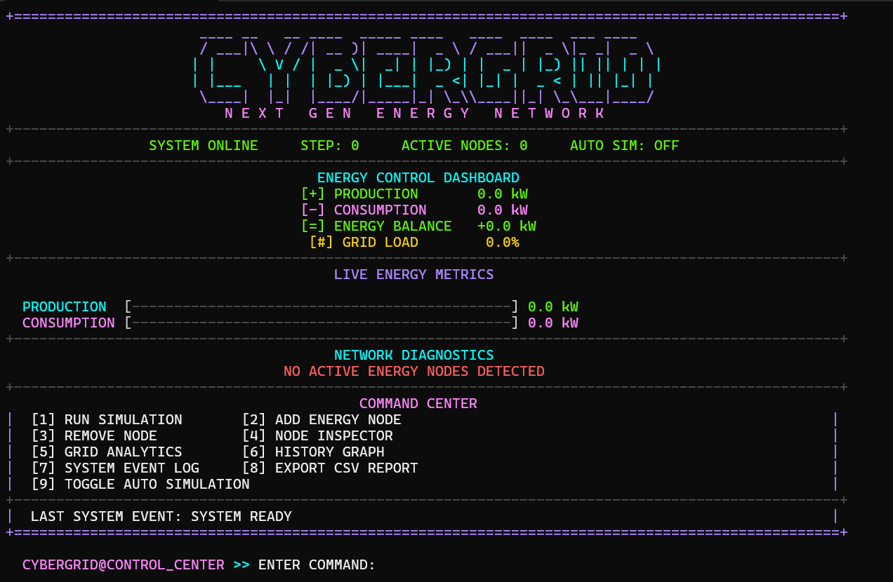
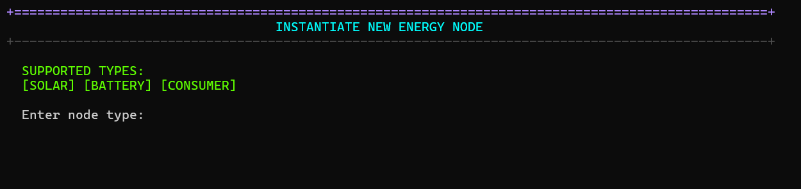
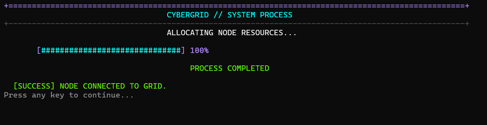
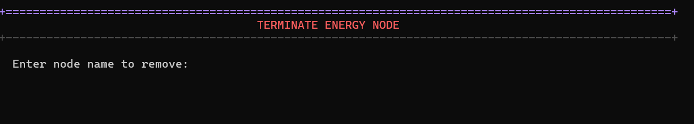
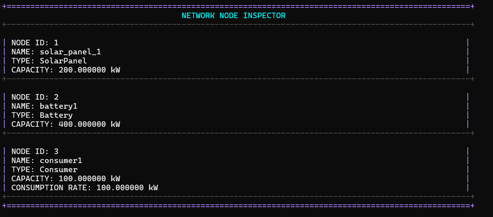
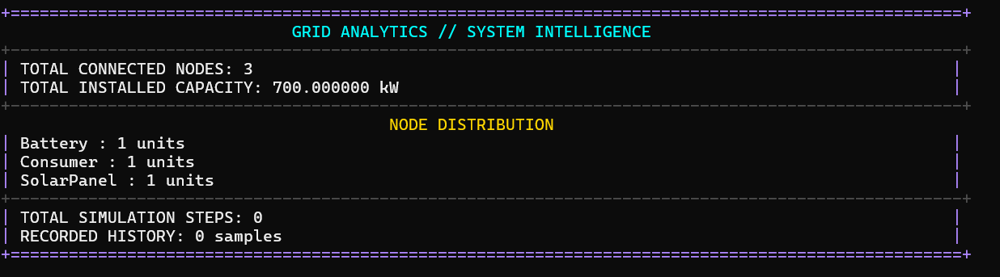
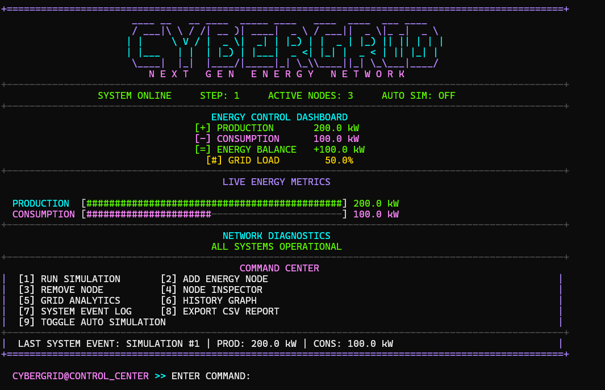
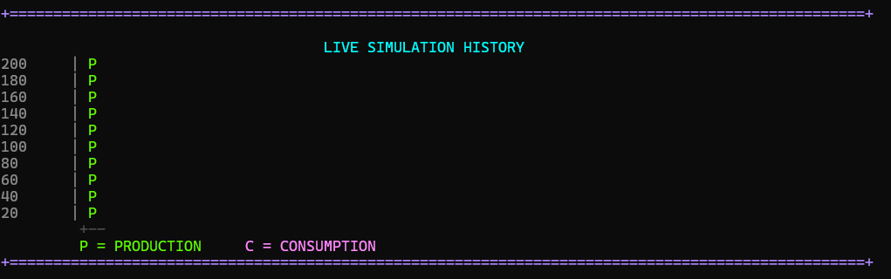
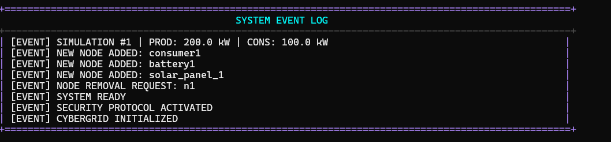

# ⚡ CYBERGRID

<p align="center">
  
</p>

<p align="center">
  A C++ energy grid simulation bringing together object-oriented programming, smart energy management, and real-time analytics.
</p>

<p align="center">
  
  
  
  
</p>

---

## ◈ 01 — OVERVIEW

**CyberGrid** is an energy grid simulation application developed in C++.

It models a network of energy producers, storage systems, and consumers, allowing users to simulate energy production, monitor consumption, and analyze the overall balance of the grid.

Designed with Object-Oriented Programming principles, CyberGrid combines structured architecture with interactive simulation and monitoring features.

> `SYSTEM STATUS: ONLINE`  
> `ENERGY NETWORK: ACTIVE`  
> `MONITORING: ENABLED`

---

## ◈ 02 — CORE FEATURES

<table>
<tr>
<td width="50%">

### ⚡ Energy Management
- Add and remove energy nodes
- Manage different energy sources
- Inspect network components
- Sort nodes by capacity

</td>
<td width="50%">

### 🔋 Energy Simulation
- Simulate grid activity
- Calculate energy production
- Monitor consumption
- Manage battery charging and discharging

</td>
</tr>
<tr>
<td width="50%">

### 📊 Analytics Dashboard
- Production and consumption statistics
- Energy balance monitoring
- Grid load calculations
- Simulation history

</td>
<td width="50%">

### 🤖 Automation
- Background simulation
- Multithreaded execution
- Synchronization of shared data
- Event logging

</td>
</tr>
</table>

### 🌐 Energy Network Components

| Component | Function |
|:--|:--|
| ☀️ Solar Panel | Generates energy from sunlight |
| 🌬️ Wind Turbine | Produces energy using wind |
| 💧 Hydro Plant | Generates energy from water flow |
| 🔋 Battery | Stores and releases energy |
| 🛢️ Diesel Generator | Generates electricity using fuel |
| 🏠 Consumer | Represents energy demand |

---

## ◈ 03 — SYSTEM ARCHITECTURE

CyberGrid is structured around an extensible energy-node architecture.

```text
                 CYBERGRID
                     │
                 EnergyGrid
                     │
                 EnergyNode
                     │
       ┌─────────────┼──────────────┐
       │             │              │
    SolarPanel   WindTurbine    HydroPlant
       │             │              │
    Battery     DieselGenerator   Consumer
```

### Core Classes

| Class | Responsibility |
|:--|:--|
| `EnergyNode` | Abstract base class for energy components |
| `EnergyGrid` | Manages nodes and simulation operations |
| `NodeFactory` | Creates energy node objects |
| `Battery` | Handles energy storage |
| `Consumer` | Represents energy consumption |
| `SolarPanel` | Models solar energy production |
| `WindTurbine` | Models wind energy production |
| `HydroPlant` | Models hydroelectric production |
| `DieselGenerator` | Models fuel-based generation |

---

## ◈ 04 — OBJECT-ORIENTED PROGRAMMING

CyberGrid demonstrates fundamental OOP principles:

- **Abstraction** — Common behavior is defined through the abstract `EnergyNode` class.
- **Inheritance** — Specialized energy components inherit from a shared base class.
- **Polymorphism** — Different energy nodes implement their own production and update behavior.
- **Encapsulation** — Each component manages its internal state through controlled interfaces.

---

## ◈ 05 — DESIGN PATTERN

### 🏭 Factory Pattern

The project uses the **Factory Design Pattern** through the `NodeFactory` class.

The factory centralizes the creation of energy node objects, separating object instantiation from the rest of the application.

```cpp
NodeFactory::createNode("solar", "Solar_01", 200, 0.8);
```

**Why use it?**

- Centralized object creation
- Reduced coupling
- Cleaner application logic
- Easier extension with additional node types

---

## ◈ 06 — TECHNOLOGY STACK

| Technology | Application |
|:--|:--|
| C++ | Core application |
| STL | Containers and algorithms |
| Visual Studio 2022 | Development environment |
| Windows API | Console configuration |
| Multithreading | Background simulation |
| Mutex & Atomic | Thread synchronization |
| Smart Pointers | Memory management |
| CSV | Data export |

---

## ◈ 07 — GETTING STARTED

### Requirements

- Windows
- Microsoft Visual Studio 2022
- Desktop development with C++ workload
- Compatible Windows SDK

### Installation

**1. Clone the repository**

```bash
git clone https://github.com/desislavaTsocheva/CyberGrid.git
```

**2. Open the solution**

```text
CyberGridOOP_Project.sln
```

**3. Configure the build**

Select:
- Configuration: `Debug` or `Release`
- Platform: `x64`

**4. Build and run**

In Visual Studio, select **Build → Build Solution**, then press `Ctrl + F5`.

---

## ◈ 08 — APPLICATION CONTROLS

| Key | Action |
|:--:|:--|
| `1` | Run energy simulation |
| `2` | Add energy node |
| `3` | Remove energy node |
| `4` | Open node inspector |
| `5` | View grid analytics |
| `6` | View simulation history |
| `7` | Open system event log |
| `8` | Export CSV report |
| `9` | Toggle background simulation |
| `ESC` | Exit application |

---

## ◈ 09 — FUTURE DEVELOPMENT

Potential improvements include:

- Additional renewable energy sources
- More advanced energy distribution algorithms
- Persistent grid configuration
- Extended analytics and visualization
- Additional simulation scenarios

---

## ◈ 10 — PROJECT PURPOSE

CyberGrid was developed as an Object-Oriented Programming project to demonstrate how C++ concepts and software design principles can be applied to a practical simulation system.

It brings together energy management, dynamic object creation, polymorphism, and multithreaded execution in one interactive application.

---

## ◈ 11- USER INTERFACE

<h2>Main Window</h2>
<p align="center">
  
</p>
<h2>Add nodes to the network</h2>
 <p align="center">
  
</p>
<h2>Operation Succeeded </h2>
 <p align="center">
  
</p>
<h2>Terminate node </h2>
<p align="center">
  
</p>
  <h2>Node Inspector </h2>

<p align="center">
  
</p>
<h2>Grid Analisys </h2>

<p align="center">
  
</p>

<h2>Start Simulation </h2>
<p align="center">
  
</p>
<h2>Simulation History </h2>

<p align="center">
  
</p>
<h2>Event log </h2>

<p align="center">
  
</p>

## ◈ DEVELOPER

<p align="center">
  <strong>DESISLAVA TSOCHEVA</strong>
  <br>
  <a href="https://github.com/desislavaTsocheva">GitHub</a>
  ·
  <a href="https://github.com/desislavaTsocheva/CyberGrid">CyberGrid Repository</a>
</p>

<p align="center">
  <br>
  <strong>⚡ SYSTEM ONLINE ⚡</strong>
  <br><br>
  💜 Made with C++ and futuristic energy.
</p>
